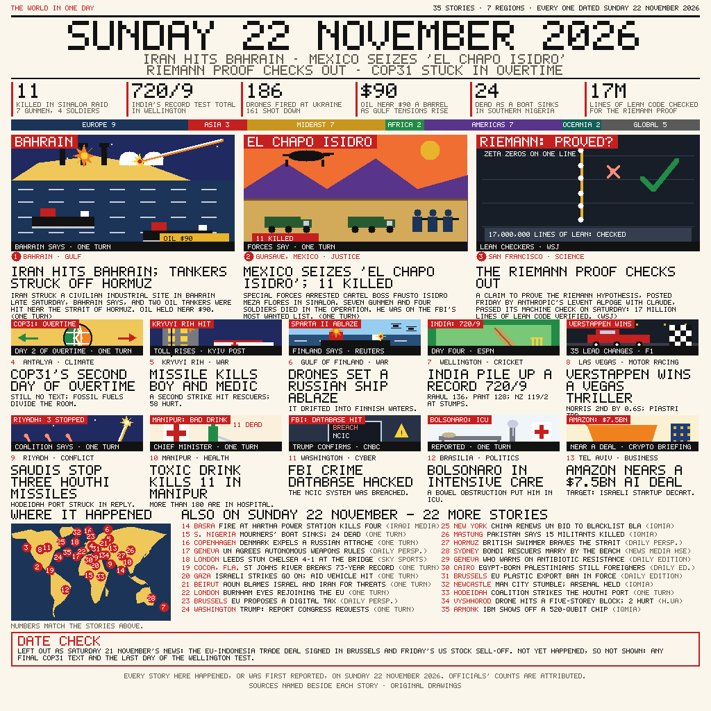

# The Day in One Image — Sunday 22 November 2026

[](https://make.fun/bounty/news-image-20261122?utm_source=github&utm_medium=readme&utm_campaign=news-image-20261122)
[](https://make.fun/bounty/news-image-20261122/leaderboard?utm_source=github&utm_medium=readme&utm_campaign=news-image-20261122)
[](https://make.fun/bounty/news-image-20261122?utm_source=github&utm_medium=readme&utm_campaign=news-image-20261122)

make.fun bounty: **"Sum up 22 November's world news in one image"**
(`make.fun/bounty/news-image-20261122`, $100, 50 winners).
Deadline: **Tue 25 Nov 2026, 00:00 UTC (07:00 WIB)**. Entry: a program writing one image
to `/output/entry.png`; an AI judge compares images pairwise.

## The image

A 1024×1024 dense front page, **"THE WORLD IN ONE DAY"**, with **35 stories**,
modelled on the leaderboard's top entry: a huge date masthead ("Sunday 22 November
2026"), a strip of six big numbers, a coloured region bar (7 regions), three lead
stories with large drawn illustrations, ten more stories in a grid with small drawn
pictograms, a numbered world map, a 22-item "also on" list, a date-check box and a
sources line. Final image:
[`output/entry.png`](output/entry.png)
(61,363 bytes, PNG, sha256
`f71444500dba43f6bc2cc2da39fb9f5af7cc2a80b5142f0f478f6dab1545b824`).



The page is drawn to read like a real newspaper at a glance: warm paper,
a black pixel masthead, red banners on the three lead stories, an orange
desert raid scene, a dark Riemann board with a green checkmark, a
seven-colour region bar (Europe blue, Asia red, Mideast gold, Africa
green, Americas purple, Oceania grey, Global dark), and a yellow world
map with red numbered pins matching the stories.

## Stories used (all dated 22 Nov 2026)

Every number was checked against reporting of Sunday 22 November 2026; figures
that could not be verified were dropped or softened. Headlines and summaries are
written in our own words.

| # | Story |
|---|-------|
| 1 | Iran hits Bahrain; tankers struck off Hormuz: Iran struck a civilian industrial site in Bahrain late Saturday, Bahrain says; two oil tankers were hit near the Strait of Hormuz; oil held near $90 |
| 2 | Mexico seizes "El Chapo Isidro"; 11 killed: special forces arrested cartel boss Fausto Isidro Meza Flores in Sinaloa; 7 gunmen and 4 soldiers died; he was on the FBI's most wanted list |
| 3 | The Riemann proof checks out: Anthropic's Levent Alpoge, with Claude, claimed a proof on Friday; on Saturday the Lean checkers verified 17 million lines of Lean code |
| 4 | COP31's second day of overtime — still no text; fossil fuels divide the room |
| 5 | Missile kills boy and medic in Kryvyi Rih — a second strike hit rescuers; 58 hurt |
| 6 | Drones set Russian ship Sparta II ablaze — it drifted into Finnish waters |
| 7 | India pile up a record 720/9 — Rahul 136, Pant 128; NZ 119/2 at stumps |
| 8 | Verstappen wins a Vegas thriller — Norris 2nd by 0.6s; Piastri 3rd; 35 lead changes |
| 9 | Saudis stop three Houthi missiles — Hodeidah port struck in reply |
| 10 | Toxic drink kills 11 in Manipur — more than 180 are in hospital |
| 11 | FBI crime database hacked — the NCIC system was breached |
| 12 | Bolsonaro in intensive care — a bowel obstruction put him in ICU |
| 13 | Amazon nears a $7.5bn AI deal — target: Israeli startup Decart |
| 14–35 | Also on: Hartha power station fire kills four; mourners' boat sinks, 24 dead; Denmark expels a Russian attache; UN agrees autonomous weapons rules; Leeds stun Chelsea 4-1; St Johns River breaks a 73-year record; Israeli strikes go on in Gaza; Aoun blames Israel and Iran; Burnham eyes rejoining the EU; EU proposes a digital tax; Trump: report Congress requests; China renews UN bid to blacklist BLA; Pakistan says 15 militants killed; British swimmer braves Hormuz; Bondi rescuers marry; WHO warns on antibiotic resistance; Egypt-born Palestinians still foreigners; EU plastic export ban in force; Man City stumble, Arsenal held; coalition strikes Hodeidah port; drone hits a five-storey block in Vyshhorod; IBM shows off a 520-qubit chip |

**Date check:** left out as Saturday 21 November's news — the EU-Indonesia trade
deal signed in Brussels and Friday's US stock sell-off. Not yet happened, so not
shown — any final COP31 text and the last day of the Wellington Test.

Sources are named beside each story; all drawings are original.

## Run it

```sh
python3 main.py   # writes output/entry.png (or /output/entry.png in the grader)
```

## Files

- `main.py` — **the entry program** (standard library only, no network,
  no clock). It runs the renderer in `main_src.py` and writes
  `/output/entry.png` (falls back to `./output/entry.png` if `/output`
  does not exist). Same bytes on every run.
- `main_src.py` — the readable source of the entry: a small rasterizer with
  an embedded 5x7 bitmap font, the news data (35 stories), thirteen drawn
  illustrations (Bahrain strike scene, Sinaloa raid, Riemann board, ten grid
  pictograms), a numbered world map, and a minimal PNG encoder (zlib).
- `output/entry.png` — the final image (also what `main.py` produces).
- `LICENSE` — MIT.
- `.makefun/owner.json` — names the entry wallet on the make.fun account.

Entered on [make.fun](https://make.fun/?ref=bp35q4sh).
